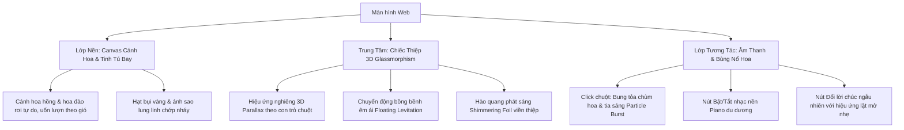

# Kế Hoạch Thiết Kế Lại Giao Diện: Thiệp Yêu Thương 8/3 Lung Linh & Tinh Tế

## 1. Mục Tiêu Thiết Kế
Tái thiết kế giao diện từ dạng form nhập liệu nhiều bước thành **một không gian trải nghiệm cảm xúc duy nhất**:
- **Trọng tâm duy nhất**: Một chiếc thiệp sang trọng, lung linh đặt tại trung tâm màn hình, tôn vinh trọn vẹn lời chúc/thông điệp 8/3.
- **Tinh giản thông tin**: Loại bỏ hoàn toàn các trường phụ (người gửi, người nhận, ngày tạo).
- **Trải nghiệm thị giác đỉnh cao**: Hiệu ứng cánh hoa bay ngập tràn (sakura / hoa hồng), bụi sao lấp lánh (stardust sparkles), chuyển động 3D Tilt mượt mà khi rê chuột và hiệu ứng chạm bung tỏa hoa.

---

## 2. Kiến Trúc & Ngôn Ngữ Thiết Kế (Design System)

### 2.1. Bảng màu & Ánh sáng (Palette & Glow)
- **Nền không gian (Ambient Background)**: Gradient hoàng hôn lãng mạn pha trộn mận chín và hồng thạch anh (`#1a081f` $\rightarrow$ `#381235` $\rightarrow$ `#2d0b28`), tạo độ tương phản cao giúp chiếc thiệp phát sáng nổi bật.
- **Màu thiệp (Card Material)**: Frosted Glassmorphism siêu thực kết hợp viền ánh kim vàng hồng (Rose Gold Foil `#e2a578` & `#ffd1dc`) với vầng hào quang chuyển sắc mềm mại (*diffused bloom glow*).
- **Chữ & Điểm nhấn**: Typography mạ vàng champagne lấp lánh (`linear-gradient(135deg, #fff7d6 0%, #ffd084 50%, #f39f5a 100%)`) và màu trắng ngọc trai.

### 2.2. Nghệ thuật Typography
- **Tiêu đề & Điểm nhấn**: Font chữ nghệ thuật bay bổng (*Dancing Script* hoặc *Great Vibes*) mang nét thư pháp hiện đại.
- **Nội dung Lời chúc**: Font serif sang trọng, nắn nót (*Cormorant Garamond* hoặc *Playfair Display*), tối ưu hiển thị tiếng Việt có dấu.
- **Nút điều khiển**: Font không chân thanh lịch (*Montserrat* / *Quicksand*).

---

## 3. Các Hiệu Ứng Chuyển Động & Tương Tác (Visual Effects)

### 3.1. Hệ thống Hạt Cánh Hoa (Canvas Physics Engine)
- Dùng HTML5 Canvas riêng biệt chạy 60 FPS, không gây giật lag.
- Kết hợp 3 loại hạt:
  1. **Cánh hoa anh đào (Sakura petals)**: Rơi lượn sóng, xoay nhẹ trong không gian 3D.
  2. **Cánh hoa hồng nhung (Rose petals)**: Rơi tự nhiên theo trọng lực và chiều gió.
  3. **Hạt bụi tiên / Ánh sao (Golden Sparkles)**: Phát sáng lấp lánh ngẫu nhiên tạo cảm giác nhiệm màu.
- Tương tác vật lý: Cánh hoa dạt ra hoặc bị cuốn theo vệt rê chuột.

### 3.2. Chiếc Thiệp 3D & Lời Chúc (Interactive 3D Card)
- **Hiệu ứng 3D Parallax Tilt**: Khi rê chuột trên màn hình, thiệp tự động nghiêng theo góc nhìn và phản chiếu ánh sáng bề mặt (Specular Reflection).
- **Nhịp thở bồng bềnh (Levitation Animation)**: Thiệp tự nâng niu bay nhẹ nhàng theo nhịp thở.
- **Nội dung lời chúc**: 
  - Hiển thị lời chúc trang trọng với dấu ngoặc kép nghệ thuật.
  - Tích hợp kho lời chúc tuyển chọn sâu sắc, ấm áp nhân ngày 8/3.
  - Nút chuyển lời chúc nhanh với hiệu ứng lật trang mềm mại (smooth fade & flip).

### 3.3. Tương tác Chạm & Trải nghiệm Âm thanh
- **Chạm/Click vào màn hình**: Bung tỏa chùm hoa và trái tim ánh sáng tại đúng vị trí con trỏ (Flower Confetti Burst).
- **Âm nhạc nền (Background Music)**: Giai điệu piano / acoustic lãng mạn nhẹ nhàng (kèm nút toggle âm thanh sang trọng ở góc phải trên).
- **Chia sẻ & Lưu giữ**: Nút sao chép lời chúc hoặc xuất ảnh thiệp thiệp đẹp mắt.

---

## 4. Kế Hoạch Thực Hiện (Phases)

| Giai đoạn | Nội dung thực hiện |
| :--- | :--- |
| **P1: Chuẩn bị Cấu trúc & Assets** | - Thiết lập lại `views/index.ejs` hoặc template thiệp chính độc lập. - Thêm thư viện icon FontAwesome, Google Fonts hỗ trợ tiếng Việt cao cấp. - Tích hợp tệp âm thanh piano nhẹ nhàng bản quyền miễn phí. |
| **P2: Engine Cánh Hoa & Sparkles Canvas** | - Xây dựng file JavaScript mô phỏng vật lý cánh hoa rơi mượt mà (`petals.js`). - Thêm hiệu ứng hạt lấp lánh (fairy dust sparkles) và tương tác gió theo chuột. |
| **P3: Tạo Dáng Thiệp & 3D CSS** | - Thiết kế thiệp Glassmorphism với viền vàng hồng bóng bẩy. - Tạo chuyển động 3D Tilt mượt mà bằng vanilla JS / CSS3 Transform. - Định dạng chữ viết nghệ thuật cho lời nhắn. |
| **P4: Tính năng & Tinh chỉnh Hoàn thiện** | - Bộ sưu tập lời chúc ngẫu nhiên + nút đổi lời chúc với chuyển cảnh mượt. - Hiệu ứng Click-to-burst cánh hoa khắp màn hình. - Kiểm tra hiển thị responsive hoàn hảo trên cả Mobile lẫn Desktop. |

---

> [!TIP]
> Bạn có thể bấm nút **Proceed** hoặc gửi phản hồi nếu muốn tùy chỉnh thêm bất kỳ chi tiết nào (ví dụ: muốn thêm hiệu ứng mở phong bì trước khi hiện thiệp, hoặc muốn tùy chọn tự gõ lời chúc riêng của bạn).
